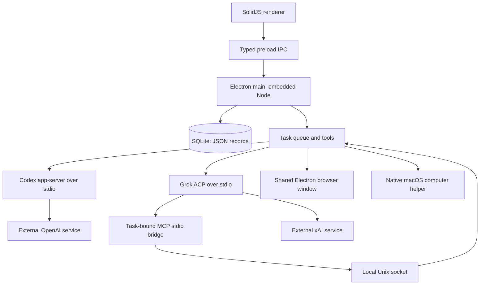

# Architecture

This describes the implementation with the local 26 October chat-hardening changes.
Toby is a macOS desktop application with
local application storage and external model inference. There is no Toby account,
hosted backend, sync service, or separate local HTTP backend.

## Processes and source layout

- `src/main/index.ts`: application lifecycle, IPC validation and snapshots.
- `src/main/harness.ts`: tasks, delegation, local tools, approvals and routines.
- `src/main/store.ts`: SQLite storage and startup recovery.
- `src/main/providers.ts`, `rpc.ts`, `runtime.ts`: provider processes, sign-in,
  model discovery, streaming and runtime preparation.
- `src/main/mcp-host.ts`, `mcp-stdio.ts`: the local task-bound MCP bridge.
- `src/main/browser.ts`, `packaging/computer.swift`: browser and Mac interaction.
- `src/main/approvals.ts`, `reset.ts`, `voice.ts`: approval summaries, reset and
  the unavailable voice service.
- `src/preload/index.ts`, `src/shared/`: the renderer API and shared contracts.
- `src/renderer/`: SolidJS UI, Markdown rendering and streaming presentation.

Bun is build and test tooling. The packaged main process uses Electron's embedded
Node runtime. The renderer has context isolation and sandboxing enabled, with
Node integration disabled. Main accepts IPC from the application's main renderer
frame, validates method names and inputs, and exposes a typed preload API.

## Local storage and context

SQLite uses WAL mode and generic `id TEXT PRIMARY KEY, data TEXT NOT NULL` tables.
Agents, groups, messages, tasks, routines, skills, memories, connectors, settings
and attachment metadata are JSON records. Shared channel facts use the additive
`group_memories` table; internal delivery receipts use `group_deliveries`. A derived internal FTS5 index and expression indexes support
membership-scoped context retrieval. See [Channel collaboration](CHANNELS.md). This is not a normalized relational
workflow schema; relations and validation are handled by application code.

Agent workspaces hold files. Users can select another workspace folder. Provider
credentials remain under provider CLI management rather than being stored as
Toby conversation records. Runtime downloads are managed locally and report byte
progress and verification state.

Agent identity and history outlive provider processes. Each task starts a fresh
provider thread/session. Direct chats receive up to the last 60 non-streaming
conversation messages, capped at 90,000 characters. Channels receive a bounded
packet of canonical public history with source IDs, shared facts, current purpose,
lead, membership and task ownership, plus paginated retrieval/search tools. The
agent's own memories and shared skills remain separate from channel memory. Native provider session IDs are not persisted
or resumed. Local storage does not mean prompts stay on the Mac: selected context
and tool results are sent to the chosen external provider.

## Scheduling, delegation and recovery

Tasks persist an owner, conversation, prompt, status, optional parent/root links
and result. The scheduler runs independent tasks concurrently, including several for the same
persistent agent, within the user setting of 1–8 simultaneous tasks (default 3).
Each task has its own provider session, tool context, approval ownership,
cancellation signal and result. Direct-chat tasks capture a bounded list of settled
public history IDs when submitted so another in-flight job cannot enter their
context later. One completed job does not mark an agent idle while another runs.
There is no fixed roster-size cap. Browser and Mac control remain exclusive to
one task; parallel jobs still share the agent workspace. See
[task execution decision](adr/0002-task-scoped-concurrency.md).

Delegation creates a child task in the recipient's private conversation or the
current group, with its briefs and output marked internal. The parent waits for
all direct children, then requeues the same task ID with private result evidence
for one synthesis. Identical child briefs to the same recipient under one parent
are reused, and delegation depth/hops and total root-tree handoffs are bounded.
Private delegation is separate from public group conversation. Every public human
message and peer reply atomically creates durable per-member delivery receipts and
participation tasks. Queued deliveries coalesce by member and origin. Each member
chooses an explicit public post, an attributed reaction, or a quiet pass; native
provider final text stays private. There is no recipient selector. One participation
turn runs per group at once, alongside at most two private worker turns within the
global limit. Replies fan out to peers; reactions and passes do not. Each member
can post twice per human round, with a bounded group total to prevent reply loops.
Member removal/hiding interrupts affected work and descendants. Channel routines
create an attributed scheduled event delivered to every member. Peer/routine text
cannot grant human authority. There is no guarantee of exactly-once external side
effects.

On startup, previously running and waiting tasks become `interrupted`, streaming messages
become `failed`, and agents become idle. Queued tasks remain eligible to run.
Queued descendants of an interrupted/failed ancestor are interrupted rather than
run. Continuing failed or interrupted work creates a new task owned by the original
root (or the user's selected replacement for ordinary work), with saved descendant evidence and
instructions to inspect history and the workspace before repeating actions. It
rejects overlapping live work and does not reconcile
external state automatically. Pending approvals are in memory and are not restored.
Review uncertain outcomes before continuing work that may have changed an external
system.

Routines use minute intervals and a 15-second scheduler check. A due routine queues
work unless an identical prompt for that agent is already queued/running, then
advances its next run from the current time. Missed intervals are not replayed one
by one. There is no cron/timezone scheduler or dedicated routine-run history table.
Background work requires a running Toby host and an awake Mac. Closing the main
window on macOS can leave the host running; quitting ends it.

## Provider and tool boundaries

OpenAI uses Codex app-server over stdio with ChatGPT account validation,
`workspace-write` for asking mode or `danger-full-access` for effective full mode,
with `on-request` approvals in both cases so the host retains control of requests. Toby tools are
registered as dynamic tools. Grok uses its CLI's stdio ACP session and cached-token
subscription authentication. Model availability is read from each provider; catalog
visibility alone does not guarantee that a subscription can run a model.

For Grok, each running task registers a random capability token and callback in
the main process. A stdio MCP bridge forwards requests over a Unix socket with
mode `0600`; the registration is removed when the task ends. Only recognized Toby
tools on that registered server can pass the provider permission layer to the
harness's own action checks. Other provider requests use explicit approval summaries;
requests whose scope cannot be explained cannot be approved in that UI.

Enabled user-configured stdio MCP connectors are passed to provider sessions.
Configuration stores a name, absolute executable path, arguments and enabled flag.
There is no built-in connector marketplace, generic OAuth manager or independent
connector sandbox. Connectors and approved shell commands execute with local user
privileges.

The central host evaluates effective per-agent access and remembered action
categories before publishing approval prompts. Full access permits known actions;
asking mode prompts for shell commands, browser clicks/typing, Mac actions and
routines without remembered grants. Specialist creation also respects its separate
automatic-creation setting. The user confirms access during onboarding, can grant
a category permanently on a prompt, and can revoke access in Settings. Revocation
stops affected active full-access sessions. Malformed/opaque requests remain blocked. Basic workspace reads/writes, memory/skill updates, delegation,
group operations and browser navigation/reading do not each show an approval.
Provider-native requests pass through the same current host policy. Native Mac
notifications cover pending approvals, new root task failures and provider failures,
with generic private copy and owning-chat navigation. Provider MCP question/form
interactions remain unsupported; no complete OpenBot parity is claimed.

The built-in file tools restrict paths to the selected workspace and check symlink
escapes. That restriction is not an OS boundary for shell commands or connectors.
Agents share one browser session and the same Mac. Task ownership prevents competing
harness tasks from using an owned browser or computer until the owner finishes;
it does not provide separate OS accounts, virtual machines, or exclusive control
over user input and every external process. Password inputs in the browser require
manual entry. Mac interaction also requires the relevant macOS permissions.

## Streaming and reset

Provider text is buffered until successful terminal completion. Codex filters by
thread/turn/item identity and phase, and completed item text replaces deltas. Grok
filters by session/message identity and selects the last post-work text segment
only after `end_turn`. Reasoning content is discarded. ACP lacks a final/commentary
phase; legacy Codex can also omit phase. The exact fallback limits and latency
tradeoff are recorded in [Chat hardening](CHAT_HARDENING.md).

Pending assistant output remains internal. Only the owning root's final response
or deliberate group post is public; worker responses are private evidence for
synthesis. A shared public projection runs before snapshot/message IPC and in the
renderer. It removes private messages, task prompt/result bodies and approval
diagnostics. Known legacy delegation traffic is filtered without modifying stored
history. Previously merged commentary cannot reliably be separated retroactively.

Full state notifications are coalesced at 30 ms; public message updates use their
own IPC event. Adjacent tool actions share a collapsed disclosure with readable
labels rather than raw provider output. A quiet indicator reports ongoing work.
The renderer preserves keyed rows and drafts, respects reduced motion, and
sanitizes rendered Markdown. New provider replies display after completion rather
than token by token. Terminal states are saved immediately; pending prose is not
published or recovered as a final answer after a crash.

Reset requires a native confirmation. It writes a pending-reset marker, shuts down
work and relaunches. Before opening storage on the next launch, Toby clears its
browser/default session storage and caches, then removes a fixed list of managed
database, workspace, runtime, probe and legacy voice-model paths. Failure leaves
the reset pending for retry. Shared provider sign-ins, macOS permissions and
folders outside Toby storage are retained; reset does not follow agent-selected
workspace paths outside that storage root.

Voice input is unavailable. There are no local speech models, active microphone
capture flow, transcription worker or speech playback. All assistant replies are
text. See [Voice](VOICE.md) and [current scope](EXPERIENCE_SCOPE.md).

## Participation and presentation — 1.0.23

The bounded group packet distinguishes newly delivered public evidence from existing
round replies, preserving source IDs and omission/truncation metadata. The model
chooses whether a useful answer, correction, question, result or quiet action remains.
Greeting restraint and usefulness are instructions, not a deterministic language
classifier. The host independently enforces publication scope/privacy, attributed
reactions, receipt delivery, exact same-author same-round body suppression and reply
budgets. Group purpose is clipped against its serialized budget, with purposeTruncated
reported, while canonical instructions remain unchanged.

Renderer layout decorates the public chronology without sorting or changing reply
relationships. Same-sender grouping and shallow local connectors are deterministic;
search retains original adjacency. Older reply references target canonical public
message IDs. Mention highlighting operates after sanitization on text nodes, skipping
code and links. Normal participation tasks remain private and are excluded from
visible work indicators; cancellation and actionable approvals remain available.

## Sibling reply layout — 1.0.24

The renderer identifies a contiguous family of replies to one actual parent ID,
independent of sender. Each sibling keeps the same single indent; same-author
continuations retain one identity. A shared stem spans real row heights and the
existing inter-row gap, terminating at the final sibling header. Chronology and
source IDs do not change. Unrelated messages, operational rows, hidden filter
positions and time/date boundaries still prevent a connector from crossing context.
This corrects the overly strict immediate-parent-only behavior from 1.0.23.
