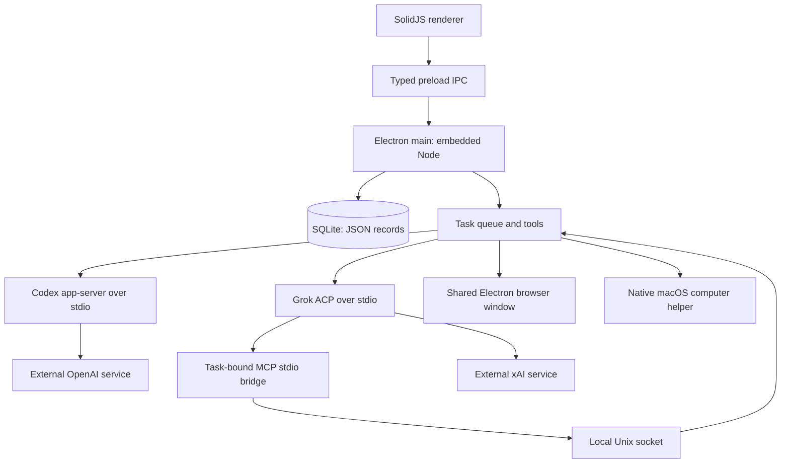

# Architecture

This describes the 1.0.6 implementation. Toby is a macOS desktop application with
local application storage and external model inference. There is no Toby account,
hosted backend, sync service, or separate local HTTP backend.

## Processes and source layout

- `src/main/index.ts`: application lifecycle, IPC validation and snapshots.
- `src/main/harness.ts`: tasks, delegation, local tools, approvals and routines.
- `src/main/store.ts`: SQLite storage and startup recovery.
- `src/main/providers.ts`, `rpc.ts`, `runtime.ts`: provider processes, sign-in,
  model discovery, streaming and runtime preparation.
- `src/main/mcp-host.ts`, `mcp-stdio.ts`: the local task-bound MCP bridge.
- `src/main/browser.ts`, `packaging/computer.swift`: browser and Mac interaction.
- `src/main/approvals.ts`, `reset.ts`, `voice.ts`: approval summaries, reset and
  the unavailable voice service.
- `src/preload/index.ts`, `src/shared/`: the renderer API and shared contracts.
- `src/renderer/`: SolidJS UI, Markdown rendering and streaming presentation.

Bun is build and test tooling. The packaged main process uses Electron's embedded
Node runtime. The renderer has context isolation and sandboxing enabled, with
Node integration disabled. Main accepts IPC from the application's main renderer
frame, validates method names and inputs, and exposes a typed preload API.

## Local storage and context

SQLite uses WAL mode and generic `id TEXT PRIMARY KEY, data TEXT NOT NULL` tables.
Agents, groups, messages, tasks, routines, skills, memories, connectors, settings
and attachment metadata are JSON records. This is not a normalized relational
workflow schema; relations and validation are handled by application code.

Agent workspaces hold files. Users can select another workspace folder. Provider
credentials remain under provider CLI management rather than being stored as
Toby conversation records. Runtime downloads are managed locally and report byte
progress and verification state.

Agent identity and history outlive provider processes. Each task starts a fresh
provider thread/session; Toby supplies up to the last 60 non-streaming conversation
messages, capped at 90,000 characters, plus the agent's memories, all saved skills
and applicable group instructions. Native provider session IDs are not persisted
or resumed. Local storage does not mean prompts stay on the Mac: selected context
and tool results are sent to the chosen external provider.

## Scheduling, delegation and recovery

Tasks persist an owner, conversation, prompt, status, optional parent/root links
and result. The scheduler runs one task per agent, with a user setting of 1–8
simultaneous tasks across agents (default 3). There is no fixed roster-size cap.

Delegation creates a child task in the recipient's private conversation or the
current group. Completion or failure queues a synthesis task for the original
owner. Identical child briefs to the same recipient under one parent are reused,
and delegation depth/hops are bounded. This is a task queue and result-return
mechanism, not a general mailbox with delivery receipts or exactly-once external
actions. Groups store membership, instructions and attributed messages; they do
not implement a dependency graph or consensus protocol.

On startup, previously running tasks become `interrupted`, streaming messages
become `failed`, and agents become idle. Queued tasks remain eligible to run.
Continuing a failed or interrupted task creates a new task with instructions to
inspect history and the workspace before repeating actions; it does not reconcile
external state automatically. Pending approvals are in memory and are not restored.
Review uncertain outcomes before continuing work that may have changed an external
system.

Routines use minute intervals and a 15-second scheduler check. A due routine queues
work unless an identical prompt for that agent is already queued/running, then
advances its next run from the current time. Missed intervals are not replayed one
by one. There is no cron/timezone scheduler or dedicated routine-run history table.
Background work requires a running Toby host and an awake Mac. Closing the main
window on macOS can leave the host running; quitting ends it.

## Provider and tool boundaries

OpenAI uses Codex app-server over stdio with ChatGPT account validation,
`workspace-write` sandbox configuration and `on-request` approvals. Toby tools are
registered as dynamic tools. Grok uses its CLI's stdio ACP session and cached-token
subscription authentication. Model availability is read from each provider; catalog
visibility alone does not guarantee that a subscription can run a model.

For Grok, each running task registers a random capability token and callback in
the main process. A stdio MCP bridge forwards requests over a Unix socket with
mode `0600`; the registration is removed when the task ends. Only recognized Toby
tools on that registered server can pass the provider permission layer to the
harness's own action checks. Other provider requests use explicit approval summaries;
requests whose scope cannot be explained cannot be approved in that UI.

Enabled user-configured stdio MCP connectors are passed to provider sessions.
Configuration stores a name, absolute executable path, arguments and enabled flag.
There is no built-in connector marketplace, generic OAuth manager or independent
connector sandbox. Connectors and approved shell commands execute with local user
privileges.

Toby asks for approval for its shell commands, browser clicks/typing, computer
actions and agent-created routines. Specialist creation asks when automatic agent
creation is disabled. Basic workspace reads/writes, memory/skill updates, delegation,
group operations and browser navigation/reading do not each show an approval.
Provider-native actions also depend on the provider's own permission requests.

The built-in file tools restrict paths to the selected workspace and check symlink
escapes. That restriction is not an OS boundary for shell commands or connectors.
Agents share one browser session and the same Mac. Task ownership prevents competing
harness tasks from using an owned browser or computer until the owner finishes;
it does not provide separate OS accounts, virtual machines, or exclusive control
over user input and every external process. Password inputs in the browser require
manual entry. Mac interaction also requires the relevant macOS permissions.

## Streaming and reset

Provider text is accumulated and emitted to the renderer in batches scheduled
24 ms apart. While text arrives, SQLite checkpoints occur when at least 250 ms
has elapsed since the previous checkpoint. Terminal states are saved immediately.
A crash may lose text after the last checkpoint. Full state notifications are
coalesced separately at 30 ms; message updates use their own IPC event. The renderer
reveals streamed text on animation frames, respects reduced motion, and sanitizes
rendered Markdown.

Reset requires a native confirmation. It writes a pending-reset marker, shuts down
work and relaunches. Before opening storage on the next launch, Toby clears its
browser/default session storage and caches, then removes a fixed list of managed
database, workspace, runtime, probe and legacy voice-model paths. Failure leaves
the reset pending for retry. Shared provider sign-ins, macOS permissions and
folders outside Toby storage are retained; reset does not follow agent-selected
workspace paths outside that storage root.

Voice input is unavailable. There are no local speech models, active microphone
capture flow, transcription worker or speech playback. All assistant replies are
text. See [Voice](VOICE.md) and [current scope](EXPERIENCE_SCOPE.md).
