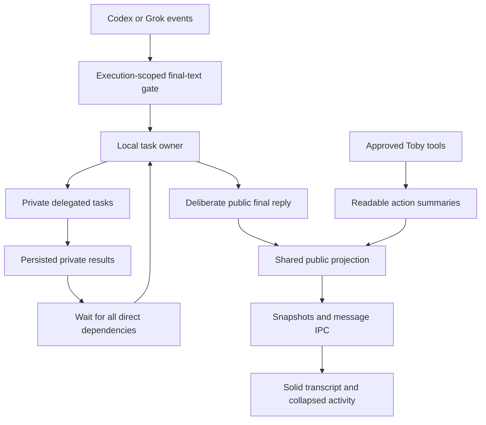

# Chat and coordination review

26 October 2026. References inspected locally: T3Code `d414cb5103`, OpenBot
`1d92ac43b`; Toby changes start from `5ac2516` (1.0.7). This is local implementation
work, not a new release. The missing 1.0.8–1.0.14 work was not reconstructed.

## Findings

| System | Pattern worth adopting | Visibility rule Toby must change |
| --- | --- | --- |
| T3Code | Typed provider events, stable per-item identity, authoritative final-text replacement, transactional projections, keyed timeline rows, deliberate scroll following and compact work disclosures. | Assistant phase is lost in the normalized message shape. The UI infers the final answer from message order and can preview reasoning or cross-agent content. Collapsing its work rows does not establish privacy. |
| OpenBot | Persistent agent identity, separate execution contexts, durable mailbox and channel assignments, explicit ownership, dependency-aware synthesis, deduplication and bounded handoffs. | Execution-thread commentary can be copied into the shared channel. Direct agent exchanges are also copied into conversation records. Its thinking filter primarily protects other model inputs, rather than the human transcript. |
| Toby before this change | Local SQLite, per-agent execution limit, typed IPC, existing approval enforcement, sanitized Markdown and stable renderer messages. | Every assistant delta was concatenated; worker replies and assignment briefs entered ordinary chats; each worker completion queued an independent synthesis; snapshots included private prompts and task results. |

T3Code source anchors:

- [Turn-item contracts](../../t3code/packages/contracts/src/orchestrationV2.ts),
  `OrchestrationV2TurnItem`, assistant versus reasoning items.
- [Codex adapter](../../t3code/apps/server/src/orchestration-v2/Adapters/CodexAdapterV2.ts),
  phase handling, provider item identity and child-thread routing.
- [Text coalescer](../../t3code/apps/server/src/orchestration-v2/Adapters/ProviderTextDeltaCoalescer.ts),
  authoritative completion replaces buffered deltas.
- [Event sink](../../t3code/apps/server/src/orchestration-v2/EventSink.ts),
  transactional append, projections and effect publication.
- [Timeline logic](../../t3code/apps/web/src/components/chat/MessagesTimeline.logic.ts),
  last-message inference and completed-turn folding.
- [Work rows](../../t3code/apps/web/src/components/chat/TimelineWorkGroupRows.tsx),
  reasoning previews and accessible disclosure controls.
- [Scroll following](../../t3code/apps/web/src/components/chat/useTimelineFollow.ts),
  user navigation, turn anchoring and following the latest work.

OpenBot source anchors:

- [Channel contracts](../../openbot/packages/contracts/src/ipc-chat-channels.ts),
  ownership, dependencies, assignment state and handoff/concurrency limits.
- [Channel service](../../openbot/src/backend/channel-service.ts),
  `capture`, assignment dispatch, completion dependencies, tool scope and recovery.
- [Channel history](../../openbot/src/backend/channel-history.ts),
  context packets and the distinction between thinking shown to the human and
  thinking excluded from another model's input.
- [Mailbox](../../openbot/src/backend/mailbox-store.ts) and
  [turn lifecycle](../../openbot/src/backend/agent/turn-lifecycle.ts),
  durable delivery, reply expectations and automatic-result deduplication.
- [Conversation projection](../../openbot/src/renderer/src/app-message-projection.ts)
  and [steps UI](../../openbot/packages/ui/src/features/conversation/AgentSteps.tsx),
  retained commentary and expandable thinking text.

These are behavioral references. Their source, branding and frameworks were not
copied into Toby.

## Provider responses and formatting

Toby uses ChatGPT subscriptions through Codex app-server and xAI subscriptions
through Grok CLI's ACP interface. It does not use a separately billed Responses,
Chat Completions or speech API.

| Event | OpenAI / Codex | xAI / Grok ACP | Toby display |
| --- | --- | --- | --- |
| Ownership | Thread, turn and item IDs. | Session ID; message ID where supplied. | Accept only the active execution. |
| Reasoning | Separate reasoning items. | `agent_thought_chunk` / thought updates. | Discard content; never render it, including inside the accordion. |
| Intermediate prose | Assistant item with `phase: commentary`. | Assistant text before a tool or subsequent reasoning/message boundary; ACP lacks a reliable final/commentary phase. | Keep out of the public transcript. |
| Tools | Non-message items and tool requests. | Tool calls and updates. | Toby-owned tools produce short action summaries; raw protocol text never becomes a bubble. Approvals retain their existing independent checks. |
| Final answer | Last explicitly final item; authoritative completed text replaces deltas. | Last text segment after observed work boundaries, with authoritative message replacement when supplied. | Publish once after successful terminal completion and coordinator checks. |
| Failure, cancellation, disconnect | Failed/interrupted terminal or RPC failure. | Non-`end_turn`, cancellation or RPC failure. | Discard provisional prose. Show a short root-task error or stopped notice, preserving the user's request. |
| Deliverable formatting | Original final text. | Original final text. | Sanitized Markdown for paragraphs, headings, lists, tables, links and fenced code. Preserve requested code/JSON exactly; do not remove prose with keyword filters. |

The adapter intentionally buffers both providers until success. This removes
token-by-token answer display and adds latency before the final answer appears.
A generic work indicator and collapsed safe activity provide progress without
revealing draft narration. Message rows, drafts, attachments, reactions and reply
targets keep their existing identity.

There are two upstream limitations. A fully unphased legacy Codex turn can only
use its last completed assistant item after the last work boundary. Grok ACP has
no semantic final marker, so unmarked narration within its final segment cannot
be distinguished from the answer. Selecting that segment is conservative, not a
proof of the model's intent. Models are instructed to put only the deliverable in
their final response; Toby never attempts to infer hidden thoughts from arbitrary
words in user-requested prose or code.

Pre-existing Toby messages can already contain commentary merged into final prose.
There is no reliable way to split those retrospectively. Known legacy delegation
records are filtered by task relationships; existing ordinary replies remain
preserved. No real profile was migrated or reset.

## Local implementation

- [Provider gate](../src/main/provider-text.ts): scope, phase, item boundaries,
  authoritative replacement and terminal completion. No reasoning-text storage.
- [Harness](../src/main/harness.ts): pending replies and worker exchanges are
  internal. A coordinator keeps one task ID, waits for every child, then resumes
  with private results to produce one synthesis. New delegated work is bounded
  across the root task tree. A worker cannot publish to a group through the public
  posting tool. Repeated identical posts are reused.
- [Public projection](../src/shared/conversation.ts): one policy for snapshots,
  live-message publication, renderer defense and model-facing public history.
  It omits internal messages and task result bodies, replaces private task prompts
  with safe summaries, and strips approval diagnostics from renderer snapshots.
- [Activity UI](../src/renderer/components/Activity.tsx): adjacent actions form one
  collapsed disclosure. A count/status is visible; friendly action labels and
  safe file references appear when expanded. Thinking and private exchanges do
  not appear in either state. The inspector no longer duplicates raw task results.
- [Recovery](../src/main/store.ts): running and waiting tasks become interrupted
  on restart. Descendants of interrupted/failed ancestors cannot automatically run.
  Stop includes queued, running and waiting work. Continuing uncertain actions
  remains an explicit user operation.

Toby retains SQLite JSON records, SolidJS, Kobalte, its existing artwork, system
typography and black theme. It does not import T3Code's orchestration framework
or OpenBot's complete event store. No new dependencies are needed.

## Verification

Regression checks cover provider phase/ownership filtering, authoritative final
replacement, cancellation/disconnect, private snapshot/live-event projection,
out-of-order and nested delegation, dependency waits, stop/restart behavior,
public-post scope and deduplication, and existing approval restrictions.

Hidden Electron DOM checks cover the collapsed activity default and expansion,
stable message rows and disclosure state across snapshots, private content absent
from chat/search/inspector, safe Markdown, drafts, replies, reactions, attachments,
groups, libraries, settings and approvals. Fixtures use isolated local data and
fake provider processes. They do not establish live subscription compatibility,
visual acceptance or frame-rate performance. No screenshots or visual QA were
performed. The source-hardening pass did not commit, push or publish. The subsequent
local 1.0.15 DMG and packaged checks are recorded in [Build verification](BUILD_REPORT.md).

Passed locally: typecheck and production build; 45 Bun tests (199 assertions);
4 Node/SQLite persistence tests; the coordination integration; 10 fake-process
provider scenarios; Grok approval and all-19-tools presentation integrations; the
hidden renderer suite; and isolated startup (`bridge: true`, `agents: 0`,
`local: true`, `errors: []`). Both reference checkouts remain clean.
