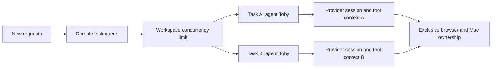

# ADR-0002: Run independent jobs per task

## Status

Implemented locally for the 27 October 2026 request to accept and execute multiple
jobs for one persistent agent. Included in the approved 1.0.24 release.

## Context

An agent represents a persistent identity, not one blocking chat turn. The host
previously keyed live executions by agent ID, so a new request queued behind that
agent even when workspace capacity was available. Approval ownership and process
cleanup also assumed a single active task per agent. Pending approval UI hid the
composer, preventing unrelated requests from being submitted.

## Decision

Keep the existing SQLite task queue, provider adapters and global concurrency
setting. Key each live execution by task ID. Existing provider RPC instances and
task-bound MCP registrations already provide separate inference and tool contexts.
Approvals, command processes, cancellation and delegated-child joins belong to the
task. Aggregate working/waiting/idle state across the agent's active tasks.

Capture up to 60 eligible public history message IDs when a direct-chat job is
submitted. Only settled exchanges are eligible; later sibling requests and their
eventual answers do not silently become that job's instructions. The current
assignment and its own private child results stay scoped to that task. Existing
saved tasks without a captured list retain a bounded submission-time fallback.

Keep the composer available beside pending approval controls. Submitting a new
job does not approve an existing action. Excess work waits in the durable queue
when the existing workspace limit is full. Stop still cancels the selected chat's
active work and descendants, without stopping unrelated chats.

## Consequences and trade-offs

- Independent requests can progress concurrently without creating extra agents.
- Per-group public participation remains serialized, preserving reply-round bounds.
- Browser reads reserve the browser session, and Mac ownership is reserved before
  awaiting approval. Two pending approvals cannot both acquire desktop control.
- Provider sessions share the selected subscription and its usage limits. Workspace
  files remain shared; this change does not provide filesystem isolation or merge
  conflicting edits automatically.
- New schema fields are optional JSON task metadata; no migration is required.
- Mid-turn restarts still mark work interrupted for review instead of replaying it.

## Alternatives considered

Retaining one execution per agent would preserve the reported blocker. Creating
specialists automatically for every request would confuse identity and consume
extra roster entries. A new worker service or process pool would add lifecycle
complexity without improving the existing per-turn provider isolation.

## Verification

Deterministic Electron tests cover concurrent same-agent requests, queue limits,
separate context and results, status aggregation, approval ownership, chat-scoped
Stop, parent synthesis, permission revocation and exclusive browser/Mac access.
Renderer fixtures check sending during active work and pending approval, plus
compact reply references. These do not certify live-provider throughput or safe
concurrent edits to the same external resource.
